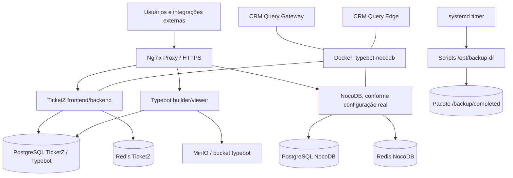

# Runbook Oficial de Disaster Recovery — Servidor Monte Celeste

**Versão:** 1.0 — revisão técnica consolidada em 24/10/2026  
**Ambiente:** Monte Celeste / servidor `tichatbot`  
**Sistema operacional de referência:** Ubuntu Server 24.04 LTS  
**Aplicações em escopo:** TicketZ, Typebot, NocoDB, CRM Query Gateway e CRM Query Edge  
**Público-alvo:** operadores iniciantes, administradores Linux e assistentes de IA em manutenção supervisionada  
**Fontes:** runbook fornecido na solicitação e arquivo `Documento Gemini(3).txt` anexado.

> **STATUS DE APROVAÇÃO:** PROCEDIMENTO CONSOLIDADO, AINDA NÃO HOMOLOGADO DE PONTA A PONTA. O pacote apresentado inclui dados NocoDB, porém **não comprova a existência de um backup da configuração de implantação do NocoDB**. Não declarar recuperação integral até resolver esta lacuna e executar teste real de restauração com evidências. Nenhum comando deste manual foi executado no servidor de produção durante a elaboração.

> **Regra essencial:** antes de qualquer restauração, preserve o backup original, confira os hashes e trabalhe em máquina limpa e isolada. **Não execute este procedimento em um servidor com dados úteis**, pois restaurar bancos e volumes substitui o estado existente.

---

## 1. Visão geral do projeto

### 1.1 Objetivo do servidor

O servidor Monte Celeste executa aplicações de atendimento e automação. O TicketZ fornece interface de atendimento e backend; o Typebot fornece criação e execução de fluxos; NocoDB oferece uma interface de banco de dados; os módulos CRM Query Gateway e CRM Query Edge integram informações e serviços. O ambiente usa Docker Compose e serviços auxiliares de banco de dados, cache, armazenamento de objetos, proxy HTTPS e emissão de certificados.

O plano de Disaster Recovery (DR) visa reconstruir esse ambiente após perda do servidor original, partindo de Ubuntu 24.04 LTS e de um pacote de backup íntegro.

### 1.2 Tecnologias e versões observadas

| Componente | Imagem/versão observada no inventário | Função | Observação |
|---|---|---|---|
| Ubuntu | 24.04 LTS | Sistema do host | Instalação limpa no destino |
| Docker / Compose | Versões não informadas | Orquestração | Verificar versão ao instalar |
| TicketZ frontend | `ghcr.io/ticketz-oss/ticketz-frontend:pro` | Interface | Tag mutável: registrar digest |
| TicketZ backend | `ghcr.io/ticketz-oss/ticketz-backend:pro` | API/atendimento | Tag mutável: registrar digest |
| Typebot builder | `baptistearno/typebot-builder:latest` | Construção de fluxos | Tag mutável: registrar digest |
| Typebot viewer | `baptistearno/typebot-viewer:latest` | Execução de fluxos | Tag mutável: registrar digest |
| PostgreSQL TicketZ/Typebot | `postgres:16-alpine` | Bancos `ticketz` e `typebot` | Compatibilidade da origem deve ser respeitada |
| Redis TicketZ | `redis:7-alpine` | Cache e filas | Persistência RDB/AOF |
| MinIO compatível | `pgsty/silo` | Objetos e mídias | Confirmar versão, configurações e API efetiva |
| NocoDB | `nocodb/nocodb:2026.07.0` | Dados e interface NoCode | Definição Compose não identificada no pacote inventariado |
| PostgreSQL NocoDB | ID de imagem `57c72fd2a128` | Banco `nocodb` | **Tag e versão exatas não documentadas** |
| Redis NocoDB | ID de imagem `6ab0b6e73817` | Cache NocoDB | **Tag e versão exatas não documentadas** |
| CRM Gateway/Edge | `node:22-alpine` | Integrações | Código e build dependem dos projetos arquivados |
| Nginx Proxy | `nginxproxy/nginx-proxy` | Proxy HTTP/HTTPS | Verificar portas, redes e arquivos vhost |
| ACME Companion | `nginxproxy/acme-companion` | Certificados TLS | Renovação exige domínio e conectividade corretos |
| Rocket.Chat / MongoDB | Rocket.Chat 6.13.1 / MongoDB 6.0 | Serviços existentes | **Fora do backup de DR apresentado** |

*As versões são um retrato do inventário anexado, não uma garantia de que os registries ainda oferecem exatamente os mesmos artefatos.*

### 1.3 Arquitetura resumida



As ligações do diagrama são **conceituais**. A topologia exata, portas publicadas, endpoints e nomes DNS internos precisam ser confirmados nos arquivos Compose e `.env` reais.

### 1.4 O que é recuperado e o que não está comprovado

**Incluído no inventário do backup:** projetos TicketZ e CRM; dumps dos bancos `ticketz`, `typebot`, `nocodb`; Redis TicketZ e NocoDB; objetos MinIO do bucket `typebot`; volumes Nginx/TicketZ e `nocodb_nocodb_data`; inventários, manifesto e hashes.

**Não comprovado:** Compose/`.env`/segredos da stack NocoDB, tags exatas de PostgreSQL/Redis NocoDB, configurações de todos os recursos externos, rotinas de backup e units do systemd dentro do pacote, permissões e usuários da aplicação, monitoramento e configuração do SFTP/chroot, e qualquer backup do Rocket.Chat/MongoDB.

---

## 2. Resumo cronológico do ambiente e do backup

O documento de origem **relata** o seguinte histórico (não representa uma auditoria de logs):

1. Inventário dos contêineres, projetos e serviços Docker.
2. Organização dos scripts de backup em `/opt/backup-dr/bin/` e funções comuns em `/opt/backup-dr/lib/`.
3. Definição dos caminhos e parâmetros em `/etc/backup-dr/backup-dr.conf` e `/etc/backup-dr/backup-dr.paths`.
4. Configuração de execução diária por `/etc/systemd/system/backup-dr.service` e `.timer`.
5. Definição de backups finalizados em `/backup/completed/`, com área temporária e registros de falha.
6. Proteção por permissões restritas, manifesto e arquivo `SHA256SUMS`.
7. Exportação dos bancos PostgreSQL e persistências Redis, objetos MinIO, volumes e projetos.
8. Retenção configurada para **7 backups válidos**, não necessariamente sete dias exatos; falhas por 30 dias.
9. Testes de extração, restauração de bancos, correção do índice `unaccent`, MinIO e acesso via arquivo `hosts`, conforme relatos no anexo.
10. Identificação de Rocket.Chat como serviço fora do escopo.

> **Importante:** a descrição da simulação no material fornecido não traz um relatório de aprovação com evidências completas de NocoDB e de todas as integrações. A validação final ainda é necessária.

---

## 3. Matriz de arquivos e diretórios

| Caminho absoluto | Conteúdo / finalidade | Cuidados |
|---|---|---|
| `/home/tichatbot/ticketz-docker-acme/` | Projeto TicketZ/Typebot, Compose, `.env` quando existentes | Não expor segredos; respeitar caminhos montados |
| `/opt/crm-query-gateway/` | Código/configuração Gateway | Validar diretório extraído e build |
| `/opt/crm-query-edge/` | Código/configuração Edge | Validar diretório extraído e build |
| **Caminho NocoDB: NÃO DOCUMENTADO** | Definição de serviços NocoDB | Levantar no servidor de origem ou backup adicional |
| `/opt/backup-dr/bin/backup-run.sh` | Orquestrador de backup | Reinstalar separadamente se não vier no pacote |
| `/opt/backup-dr/bin/backup-check-pre.sh` | Pré-checagens | Consultar código real antes de alteração |
| `/opt/backup-dr/bin/backup-execution-id.sh` | Identificador de execução | Consultar código real |
| `/opt/backup-dr/bin/backup-configs.sh` | Exportação dos projetos | Consultar código real |
| `/opt/backup-dr/bin/backup-postgres.sh` | Dumps PostgreSQL | Consultar código real |
| `/opt/backup-dr/bin/backup-redis.sh` | Exportação Redis | Consultar código real |
| `/opt/backup-dr/bin/backup-minio.sh` | Exportação MinIO | Consultar código real |
| `/opt/backup-dr/bin/backup-volumes.sh` | Arquivos de volumes Docker | Consultar código real |
| `/opt/backup-dr/bin/backup-retention.sh` | Retenção e limpeza | Evitar exclusões manuais |
| `/opt/backup-dr/lib/backup-common.sh` | Funções compartilhadas | Dependência dos scripts |
| `/opt/backup-dr/README.md` | Orientações originais | Preservar junto à automação |
| `/etc/backup-dr/backup-dr.conf` | Parâmetros sem segredos | Permissões `0600` root |
| `/etc/backup-dr/backup-dr.paths` | Relação de caminhos | Conteúdo não fornecido; conferir |
| `/etc/systemd/system/backup-dr.service` | Serviço de execução única | Executa como root |
| `/etc/systemd/system/backup-dr.timer` | Agendamento diário | Host em UTC no material original |
| `/backup/.staging/` | Pacote em preparação | Não tratar como backup concluído |
| `/backup/completed/` | Pacotes finalizados | Verificar `BACKUP_OK` e checksums |
| `/backup/failed/` | Falhas | Retenção distinta |
| `/backup/retention/` | Apoio à retenção | Função exata depende dos scripts |
| `/var/log/backup-dr/` | Logs locais | Consultar também journald |
| `/tmp/backup_restore/` | Destino de transferência proposto | `tmp` não é destino seguro permanente |
| `/etc/hosts` (Windows: `C:\Windows\System32\drivers\etc\hosts`) | Resolução de domínios de teste | Não altera DNS público |

### 3.1 Estrutura de exemplo do pacote de 22/10/2026

```
<BACKUP_ID>/
├── BACKUP_OK
├── NOTIFICATION_SENT
├── SHA256SUMS
├── manifest/manifest.json
├── configs/
│   ├── ticketz-project.tar.zst
│   ├── crm-gateway.tar.zst
│   └── crm-edge.tar.zst
├── postgres/
│   ├── ticketz-cluster/{globals.sql,ticketz.dump,typebot.dump,validation/}
│   └── nocodb-cluster/{globals.sql,nocodb.dump,validation/}
├── redis/
│   ├── ticketz-redis/{dump.rdb,appendonlydir/,info-*.txt}
│   └── nocodb-redis/{dump.rdb,appendonlydir/,info-*.txt}
├── minio/
│   ├── buckets.txt
│   ├── buckets-inventory.txt
│   └── typebot/inventory.txt
└── volumes/
    ├── nocodb_nocodb_data.tar.zst
    ├── ticketz-docker-acme_backend_private.tar.zst
    ├── ticketz-docker-acme_backend_public.tar.zst
    └── ticketz-docker-acme_ngx_*.tar.zst
```

O inventário lista apenas `minio/typebot/inventory.txt`; **não comprova pela listagem, isoladamente, que haja arquivos de mídia do bucket**. Verificar objetos concretos, inventário e manifesto no pacote recebido.

---

## 4. Parâmetros configuráveis documentados

| Variável/valor | Valor de referência | Onde alterar / como validar |
|---|---|---|
| `BACKUP_ROOT` | `/backup` | `/etc/backup-dr/backup-dr.conf`; criar destino e verificar espaço/permissões |
| `STAGING_ROOT` | `/backup/.staging` | Mesmo arquivo |
| `COMPLETED_ROOT` | `/backup/completed` | Mesmo arquivo |
| `FAILED_ROOT` | `/backup/failed` | Mesmo arquivo |
| `RETENTION_ROOT` | `/backup/retention` | Mesmo arquivo |
| `LOG_ROOT` | `/var/log/backup-dr` | Mesmo arquivo |
| `KEEP_VALID_BACKUPS` | `7` | Número de backups válidos conforme nome e documentação; confirmar lógica no script |
| `KEEP_FAILED_DAYS` | `30` | Dias de preservação de falhas |
| `MIN_FREE_GIB` | `30` | Espaço livre mínimo indicado |
| `TIMEZONE` | `America/Sao_Paulo` | Metadado do backup; não determina sozinho timezone do host |
| `ENCRYPTION_ENABLED` | `false` | Backup não criptografado, alto cuidado no transporte |
| `POSTGRES_TICKETZ_CONTAINER` | `ticketz-docker-acme-postgres-1` | Nome do contêiner; consultar `docker ps` |
| `POSTGRES_NOCODB_CONTAINER` | `nocodb-postgres` | Conferir stack NocoDB |
| `POSTGRES_TICKETZ_DATABASES` | `ticketz typebot` | Restaurar ambos |
| `POSTGRES_NOCODB_DATABASES` | `nocodb` | Restaurar no cluster separado |
| `REDIS_TICKETZ_CONTAINER` | `ticketz-docker-acme-redis-1` | Conferir mounts e persistência |
| `REDIS_NOCODB_CONTAINER` | `nocodb-redis` | Conferir mounts e persistência |
| `MINIO_CONTAINER` | `ticketz-docker-acme-minio-1` | Conferir hostname e credenciais |
| `TICKETZ_PROJECT_DIR` | `/home/tichatbot/ticketz-docker-acme` | Preservar para Compose e montagens |
| `CRM_GATEWAY_DIR` | `/opt/crm-query-gateway` | Conferir nome de pasta extraída |
| `CRM_EDGE_DIR` | `/opt/crm-query-edge` | Conferir nome de pasta extraída |
| `BACKUP_SERVICE_NAME` | `backup-dr.service` | Nome da unit systemd |
| Rede externa | `typebot-nocodb` | Docker + `networks: external: true` nos Compose que a usam |
| Bucket | `typebot` | Storage MinIO; verificar variável/configuração real |
| `VIRTUAL_HOST`, `LETSENCRYPT_HOST` | **Não informados** | Localizar nos Compose/`.env` reais; não inventar domínios |
| `META_TOKEN` | **Não informado** | Buscar referências nos `.env`; não imprimir valor em logs |
| Credenciais PostgreSQL/Redis/MinIO | **Não informadas** | `.env` / secretos / configurações da stack real |
| Portas publicadas e IDs | **Não informados** | `docker compose config`, `docker inspect` e arquivos reais |

**Nunca documentar senhas ou tokens em texto claro neste runbook.** O processo deve registrar apenas o nome da variável, sua origem e o procedimento de rotação. Para alterar `.env`: criar cópia protegida, editar, executar `docker compose config --quiet`, reiniciar **somente os serviços impactados** com `docker compose up -d --no-deps <servico>`, verificar logs e conectividade. Rotação de senha de banco requer alteração coordenada no servidor de banco e nos clientes; mudar apenas uma variável não altera automaticamente senha gravada em banco inicializado.

---

# PARTE II — RESTAURAÇÃO COMPLETA

## 5. Condições de início e planejamento

### 5.1 Inventário obrigatório antes do incidente

Em produção, manter também, em cofre seguro fora do host:

- Compose e `.env` reais do NocoDB (ou documentação reproduzível com versões, rede e volumes); verificar se já existem em outro backup.
- Compose expandido de todas as stacks (`docker compose config`, protegendo segredos).
- Resultado de `docker ps --format`, `docker inspect` resumido de mounts/redes, tags e digests (`docker image inspect`).
- Esquema de DNS, domínio, hosts virtuais, entradas CNAME/A, firewall e roteador.
- Cofre de credenciais e procedimentos de rotação para Meta, PostgreSQL, Redis, MinIO, JWT, sessão, Webhooks e SMTP.
- Procedimento para restaurar `/opt/backup-dr`, `/etc/backup-dr`, units systemd e configuração SFTP.
- Lista de integrações externas e como suspender envios durante o teste.

### 5.2 Riscos e critérios de interrupção

**PARE** se: `SHA256SUMS` apresentar falha; `BACKUP_OK` não existir; dumps estiverem vazios; faltar configuração NocoDB para recuperar NocoDB; o host de destino não estiver vazio; houver conflito com IP/domínios de produção; o backup MinIO não contiver objetos esperados; versões de bancos forem incompatíveis; faltar credencial necessária; a rede não puder ser isolada.

### 5.3 Restaurar em laboratório versus substituir produção

**Laboratório:** usar VM/rede privada, impedir saída para plataformas de mensagem, SMTP e webhooks; configurar DNS de teste local, não publicar as mesmas portas/domínios publicamente. Trocar o token Meta por uma string inválida é **insuficiente** para impedir outros efeitos, como webhooks, filas, SMTP e integrações de terceiros. Preferir regras de egress/firewall e desabilitar trabalhadores/consumidores quando possível. Internet pode ser liberada temporariamente apenas para download de imagens, com bloqueio posterior antes da inicialização de aplicações.

**Produção:** aprovar janela, confirmar backup mais recente, registrar ponto de recuperação (RPO), verificar como direcionar DNS e evitar duas instalações simultâneas processando as mesmas contas e filas. Preservar antigo host desligado ou isolado antes de abrir tráfego no novo.

## 6. Fase A — preparar Ubuntu 24.04 LTS

Executar como operador com `sudo`. Recomenda-se sessão persistente (`tmux`) e registro de alterações; **não grave credenciais no transcript**.

```bash
sudo apt-get update
sudo apt-get install -y ca-certificates curl zstd tar acl jq openssl postgresql-client redis-tools tmux
sudo timedatectl set-timezone Etc/UTC
sudo timedatectl status
```

Instalação rápida do Docker conforme runbook original:

```bash
curl -fsSL https://get.docker.com -o /tmp/get-docker.sh
# Revisar o instalador e executar somente após aprovação operacional
sudo sh /tmp/get-docker.sh
sudo systemctl enable --now docker
sudo docker version
sudo docker compose version
```

A instalação por script é conveniente, mas para ambiente controlado prefira o repositório oficial Docker com versões fixadas. `sudo usermod -aG docker "$USER"` é opcional e concede privilégios equivalentes a root; usar `sudo docker` é mais seguro para operadores temporários. Se usar grupo docker, será necessário novo login.

**Espaço:** assegurar espaço suficiente para pacote comprimido, dados extraídos, volumes, imagens e crescimento de banco. O mínimo de 30 GiB no backup original não é garantia de espaço suficiente para restore.

## 7. Fase B — localizar, selecionar e validar pacote

Não escolher automaticamente a primeira subpasta de `/tmp/backup_restore`, pois ela pode estar errada. Listar pacotes e selecionar explicitamente um diretório com marcadores válidos.

```bash
sudo find /tmp/backup_restore -mindepth 1 -maxdepth 2 -type f -name BACKUP_OK -print
sudo ls -lah /tmp/backup_restore
```

Após confirmar visualmente a identificação correta, **substituir o caminho no comando abaixo**:

```bash
export BKP_DIR='/tmp/backup_restore/2026-10-22_02h01m20s'
test -d "$BKP_DIR" && test -f "$BKP_DIR/BACKUP_OK" && test -f "$BKP_DIR/SHA256SUMS" || { echo 'Backup incompleto'; exit 1; }
(cd "$BKP_DIR" && sha256sum -c SHA256SUMS) || { echo 'Falha de integridade'; exit 1; }
find "$BKP_DIR" -maxdepth 3 -type f | sort
```

**Obs.:** `exit 1` só interrompe imediatamente se executado em sessão/script apropriado. Em scripts mantenha `set -euo pipefail`; no terminal, não prossiga após erro. O arquivo `NOTIFICATION_SENT` indica registro de notificação, **não** comprova consistência de todos os bancos. O SHA256 comprova correspondência de conteúdo com o manifesto de hashes, não a fidelidade do backup original.

Checagens de estrutura:

```bash
for p in \
 configs/ticketz-project.tar.zst configs/crm-gateway.tar.zst configs/crm-edge.tar.zst \
 postgres/ticketz-cluster/ticketz.dump postgres/ticketz-cluster/typebot.dump \
 postgres/nocodb-cluster/nocodb.dump; do
  test -s "$BKP_DIR/$p" || echo "FALTA/VAZIO: $p"
done
for f in "$BKP_DIR"/configs/*.tar.zst "$BKP_DIR"/volumes/*.tar.zst; do
  test -f "$f" || continue
  zstd -t "$f" || exit 1
done
cat "$BKP_DIR/minio/buckets.txt"
```

Inspecionar arquivos antes de extração para impedir caminhos inesperados e entender layout:

```bash
tar --zstd -tf "$BKP_DIR/configs/ticketz-project.tar.zst" | head -30
tar --zstd -tf "$BKP_DIR/configs/crm-gateway.tar.zst" | head -30
tar --zstd -tf "$BKP_DIR/configs/crm-edge.tar.zst" | head -30
```

Se o backup foi transferido de Windows/WinSCP, validar novamente os hashes **no destino**. Restrinja leitura de diretório e use um volume não efêmero se precisar preservar os dados.

## 8. Fase C — extrair configurações e descobrir definições reais

```bash
sudo install -d -m 700 /home/tichatbot /opt/crm-query-gateway /opt/crm-query-edge
sudo tar --zstd -xf "$BKP_DIR/configs/ticketz-project.tar.zst" -C /home/tichatbot/
sudo tar --zstd -xf "$BKP_DIR/configs/crm-gateway.tar.zst" -C /opt/
sudo tar --zstd -xf "$BKP_DIR/configs/crm-edge.tar.zst" -C /opt/
```

**Atenção:** isso supõe que o tar contém a pasta superior `ticketz-docker-acme`, `crm-query-gateway` ou `crm-query-edge`. Se os tars contiverem somente arquivos internos, alterar o diretório `-C` após consultar `tar -tf`; não extrair duas vezes por tentativa.

```bash
sudo ls -lah /home/tichatbot/ticketz-docker-acme
sudo ls -lah /opt/crm-query-gateway /opt/crm-query-edge
# Evitar imprimir conteúdo de .env em terminal compartilhado.
(cd /home/tichatbot/ticketz-docker-acme && sudo docker compose config --quiet)
(cd /opt/crm-query-gateway && sudo docker compose config --quiet)
(cd /opt/crm-query-edge && sudo docker compose config --quiet)
```

Usar `docker compose config --services`, `--volumes` e `--networks` para descobrir nomes reais. **Não assumir nomes de serviços nem volumes apenas pelos nomes de contêineres.** Conferir mount bind versus volume nomeado, caminhos absolutos e segredos. Verificar que todos os `.env` necessários foram exportados: uma configuração ausente pode resultar em um serviço que sobe mas não funciona.

### 8.1 Bloqueio crítico — NocoDB

O backup **não lista** arquivo `configs/nocodb*.tar.zst`. O NocoDB está operacional no inventário, mas seus arquivos `compose.yaml`, `.env`, volumes de PostgreSQL e Redis e sua localização exata **não foram fornecidos**. Para garantir recuperação integral:

1. Localizar a definição original no host de produção ou em backup secundário. Pesquisar somente arquivos Compose e registrar o diretório real.
2. Salvar as imagens exatas e respectivas variáveis, bind mounts, volumes, networks, portas, parâmetros de PostgreSQL/Redis, senha, URL NocoDB e segredo de autenticação.
3. Recuperar essa configuração antes de iniciar NocoDB ou seus bancos.
4. Se não houver configurações originais, não improvisar credenciais/rede/versão; reconstruir mediante inventário técnico aprovado e registrar como **recuperação parcial** até validar funcionalidades.

No **host original**, comandos úteis de inventário (sem exportar segredos a canais públicos):

```bash
sudo docker inspect nocodb-app nocodb-postgres nocodb-redis \
 --format '{{.Name}}: {{json .Config.Labels}}'
sudo docker inspect nocodb-app --format '{{json .Mounts}}'
sudo docker inspect nocodb-postgres --format '{{json .Mounts}}'
sudo docker inspect nocodb-redis --format '{{json .Mounts}}'
sudo docker image inspect 57c72fd2a128 --format '{{json .RepoTags}} {{json .RepoDigests}}'
sudo docker image inspect 6ab0b6e73817 --format '{{json .RepoTags}} {{json .RepoDigests}}'
```

Se o servidor original foi destruído, esta descoberta pode ser impossível. O manual não inventa um Compose inexistente.

## 9. Fase D — imagens, redes e volumes

### 9.1 Baixar imagens sem iniciar aplicações

```bash
cd /home/tichatbot/ticketz-docker-acme && sudo docker compose pull
cd /opt/crm-query-gateway && sudo docker compose pull
cd /opt/crm-query-edge && sudo docker compose pull
```

Se houver `build:` sem imagem publicada, construir (`docker compose build`) com o código restaurado, observando `Dockerfile`, caches e dependências. Quando as tags são `latest` ou `pro`, `pull` pode obter uma versão **diferente da usada no backup**: usar digests/inventário de imagens do momento do backup sempre que disponível. **NocoDB:** baixar as imagens pelo Compose verdadeiro recuperado, nunca presumir versão de `postgres`/`redis` a partir de IDs de imagem.

### 9.2 Rede externa

```bash
sudo docker network inspect typebot-nocodb >/dev/null 2>&1 || \
  sudo docker network create typebot-nocodb
sudo docker network inspect typebot-nocodb
```

O nome foi documentado. Outras redes declaradas como `external: true` também precisam ser recriadas segundo os arquivos reais. As redes internas do Compose serão criadas pelo Docker.

### 9.3 Restaurar volumes *estáticos* em host limpo

Antes, confirme que não há contêineres usando os volumes. O volume `nocodb_nocodb_data` é apresentado no inventário e pode ser restaurado, mas sua função exata precisa ser confirmada pelos mounts do NocoDB.

```bash
cd "$BKP_DIR/volumes" || exit 1
shopt -s nullglob
archives=( *.tar.zst )
((${#archives[@]} > 0)) || { echo 'Nenhum volume arquivado'; exit 1; }
for vol_archive in "${archives[@]}"; do
  vol_name="${vol_archive%.tar.zst}"
  echo "Restaurando: $vol_name"
  sudo docker volume inspect "$vol_name" >/dev/null 2>&1 || sudo docker volume create "$vol_name" >/dev/null
  # Somente após verificar que é volume exclusivo do restore e ainda vazio.
  vol_path=$(sudo docker volume inspect "$vol_name" --format '{{.Mountpoint}}')
  sudo tar --zstd -xf "$vol_archive" -C "$vol_path" --same-owner
  sudo find "$vol_path" -maxdepth 1 -mindepth 1 -printf '%f\n' | head
 done
```

**Nota de propriedade:** `--same-owner` preserva UID/GID do arquivo original e deve ser usado somente com backup confiável, em servidor de restauração isolado. Conferir proprietários, permissões e nomes de diretório antes de iniciar contêineres; usuários internos podem diferir entre versões das imagens. Nunca use `docker volume rm` indiscriminadamente. Nomes de volume devem ser idênticos aos que Compose usará; volumes com `external` e projetos diferentes podem não coincidir.

> **ATENÇÃO:** a restauração de volumes **não** restaura automaticamente o Redis nem PostgreSQL porque os pacotes estão separados em `redis/` e `postgres/`. Restaurá-los nas etapas seguintes.

## 10. Fase E — subir somente bancos e armazenamento

Os comandos deste bloco são conhecidos **apenas** para TicketZ. A definição NocoDB exige o Compose confirmado.

```bash
cd /home/tichatbot/ticketz-docker-acme
sudo docker compose config --services
sudo docker compose up -d postgres minio
```

Conferir health em vez de um `sleep 15` fixo:

```bash
sudo docker ps --filter name=ticketz-docker-acme-postgres-1
sudo docker exec ticketz-docker-acme-postgres-1 pg_isready -U ticketz
sudo docker logs --tail=80 ticketz-docker-acme-postgres-1
```

Se o nome do serviço real divergir, substituir `postgres`/`minio`. Não subir frontend, backend, Typebot, CRM ou NocoDB ainda. Criar bancos ausentes somente após confirmar usuários e ownership reais.

## 11. Fase F — restaurar PostgreSQL TicketZ/Typebot

### 11.1 Pré-condições

- PostgreSQL destino compatível com o dump e extensões instaladas.
- Conta de restore com privilégios de criação de roles, bancos, extensões e objetos.
- Bancos de destino vazios ou deliberadamente descartáveis.
- Aplicações paradas. Validar dumps com `pg_restore --list` usando cliente compatível.

```bash
PG_DIR="$BKP_DIR/postgres"
pg_restore --list "$PG_DIR/ticketz-cluster/ticketz.dump" >/dev/null
pg_restore --list "$PG_DIR/ticketz-cluster/typebot.dump" >/dev/null
```

### 11.2 Globals e papéis

O anexo sugere importar `globals.sql` com `psql -U ticketz`, mas **não está comprovado** que o usuário `ticketz` seja superusuário nem que `globals.sql` seja reaplicável sem erros em cluster recém-inicializado. Inspecione o SQL (sem divulgar hashes de senhas) e decida se usa o superusuário configurado no cluster. `globals.sql` pode conter `CREATE ROLE`, alterações de senha e permissões.

Exemplo condicionado à confirmação de privilégios:

```bash
# Somente se o usuário 'ticketz' tiver privilégios suficientes e o SQL tiver sido revisado:
sudo docker exec -i ticketz-docker-acme-postgres-1 \
  psql -X -v ON_ERROR_STOP=1 -U ticketz -d postgres \
  < "$PG_DIR/ticketz-cluster/globals.sql"
```

Se falhar por role existente ou falta de privilégio, **não ignore** nem continue cegamente. Revisar roles e restaurar sob a conta administrativa efetiva.

### 11.3 Preparar bancos e importar dumps

O banco `ticketz` normalmente é inicializado pelo contêiner; confirme existência e dono. O banco `typebot` deve ser criado se não existir, com proprietário compatível. O comando seguinte é idempotente apenas no teste de existência; execute em cluster restaurável:

```bash
sudo docker exec ticketz-docker-acme-postgres-1 \
  psql -X -v ON_ERROR_STOP=1 -U ticketz -d postgres -tAc \
  "SELECT datname FROM pg_database WHERE datname IN ('ticketz','typebot')"

if ! sudo docker exec ticketz-docker-acme-postgres-1 \
  psql -X -U ticketz -d postgres -tAc \
  "SELECT 1 FROM pg_database WHERE datname='typebot'" | grep -qx 1; then
  sudo docker exec ticketz-docker-acme-postgres-1 \
    psql -X -v ON_ERROR_STOP=1 -U ticketz -d postgres \
    -c 'CREATE DATABASE typebot OWNER ticketz;'
fi
```

**Em banco limpo**, preferir importação com parada em erros:

```bash
sudo docker exec -i ticketz-docker-acme-postgres-1 \
  pg_restore -U ticketz -d ticketz --exit-on-error --verbose \
  < "$PG_DIR/ticketz-cluster/ticketz.dump"

sudo docker exec -i ticketz-docker-acme-postgres-1 \
  pg_restore -U ticketz -d typebot --exit-on-error --verbose \
  < "$PG_DIR/ticketz-cluster/typebot.dump"
```

**Atenção:** se o Compose já criou objetos, avaliar `--clean --if-exists` **apenas no banco de destino de restore**, pois remove objetos. `pg_restore --create` só deve ser usado se o formato do dump e política de nomes permitirem. Problemas de ownership podem requerer `--no-owner` ou execução pelo administrador, porém isso muda propriedades e deve ser deliberado. Não ocultar stderr nem usar `|| true`.

### 11.4 Tratamento especial do índice `unaccent`

A origem registra a seguinte correção, aplicada **após o restore**:

```sql
ALTER FUNCTION public.immutable_unaccent(text)
  SET search_path = public, pg_temp;
CREATE INDEX IF NOT EXISTS tags_name_unaccent_lower_index
  ON public."Tags" USING btree
  (public.immutable_unaccent(lower((name)::text)));
```

**Não aplicar automaticamente no escuro.** Primeiro verificar se a função e tabela existem, se o índice foi criado no restore e se o corpo da função é seguro/estável. Alterar `search_path` por si só não garante que a função seja adequada para índices; `immutable_unaccent` costuma envolver decisões de imutabilidade que precisam ser auditadas. Este workaround é específico do ambiente documentado, não uma solução universal.

```bash
sudo docker exec ticketz-docker-acme-postgres-1 psql -X -U ticketz -d ticketz -c \
 "SELECT to_regprocedure('public.immutable_unaccent(text)') AS funcao, to_regclass('public.\"Tags\"') AS tabela, to_regclass('public.tags_name_unaccent_lower_index') AS indice;"
```

Se o índice estiver ausente e a função confirmada, aplicar a correção original com operador DBA e, depois, repetir inspeção. `CREATE INDEX IF NOT EXISTS` verifica nome, **não** a equivalência da definição: conferir `pg_indexes.indexdef`.

### 11.5 Validar

```bash
sudo docker exec ticketz-docker-acme-postgres-1 psql -X -U ticketz -d ticketz \
  -c 'SELECT current_database(), version();'
sudo docker exec ticketz-docker-acme-postgres-1 psql -X -U ticketz -d typebot \
  -c 'SELECT current_database(), version();'
sudo docker exec ticketz-docker-acme-postgres-1 psql -X -U ticketz -d ticketz \
  -c "SELECT schemaname, indexname, indexdef FROM pg_indexes WHERE indexname='tags_name_unaccent_lower_index';"
```

Contar tabelas e comparar com evidências da origem; verificar role de cada objeto e erros de extensões. Arquivos `validation/*.list` são listagens do conteúdo de dumps, não garantia de saúde funcional.

## 12. Fase G — restaurar PostgreSQL NocoDB (OBRIGATÓRIO)

O pacote contém `postgres/nocodb-cluster/globals.sql` e `nocodb.dump`, porém o runbook original não os injetava. Este é um dos maiores bloqueios à recuperação integral.

**Primeiro:** recuperar Compose verdadeiro do NocoDB; iniciar **somente** `nocodb-postgres` ou o nome de serviço que produz o contêiner `nocodb-postgres`. Consultar user/db/major version no Compose e credenciais reais. **Não** usar o PostgreSQL TicketZ para o dump NocoDB.

```bash
pg_restore --list "$BKP_DIR/postgres/nocodb-cluster/nocodb.dump" >/dev/null
sudo docker exec nocodb-postgres pg_isready
```

A seguir, **modelo a adaptar** após inspecionar `POSTGRES_USER`, `POSTGRES_DB`, `POSTGRES_PASSWORD`, roles e direitos. Ele pressupõe que `nocodb` é usuário com direitos suficientes — **não comprovado**:

```bash
# Exemplo condicionado à validação dos papéis e nomes:
sudo docker exec -i nocodb-postgres psql -X -v ON_ERROR_STOP=1 -U nocodb -d postgres \
  < "$BKP_DIR/postgres/nocodb-cluster/globals.sql"

sudo docker exec -i nocodb-postgres pg_restore -U nocodb -d nocodb \
  --exit-on-error --verbose \
  < "$BKP_DIR/postgres/nocodb-cluster/nocodb.dump"
```

Se as credenciais/roles não coincidirem, usar o administrador real e preparar o banco/dono antes. Comparar contagem de tabelas, extensões, ownership e login NocoDB. Não prosseguir até resolver os erros.

## 13. Fase H — restaurar Redis TicketZ e NocoDB

### 13.1 Por que é delicado

O backup possui `dump.rdb` **e** `appendonlydir/` para os dois Redis. Quando AOF está habilitado, a recuperação costuma priorizar o AOF; se o manifesto ou arquivos não forem coerentes, as filas podem sumir ou o Redis pode se recusar a iniciar. Restaurar somente RDB não garante recuperação das filas.

### 13.2 Mapear persistência REAL

```bash
cd /home/tichatbot/ticketz-docker-acme
sudo docker compose up -d redis
sudo docker exec ticketz-docker-acme-redis-1 redis-cli CONFIG GET dir appendonly appendfilename dbfilename
sudo docker inspect ticketz-docker-acme-redis-1 --format '{{json .Mounts}}'
sudo docker compose stop redis
```

Se Redis usa senha, adaptar `redis-cli` a uma forma segura de autenticação; não passar senha como argumento visível no histórico. O nome presumido `ticketz-docker-acme_redis_data` no runbook **não foi confirmado** na relação dos arquivos de volumes; checar `docker inspect` para caminho real. Se mount for bind, a restauração não é feita em um volume nomeado.

### 13.3 Cópia física com serviço parado

**Modelo para volume nomeado**, somente depois de confirmar o mount de destino `/data` e o nome real do volume:

```bash
# SUBSTITUIR pelo volume real identificado via docker inspect:
REDIS_VOLUME='ticketz-docker-acme_redis_data'
REDIS_PATH=$(sudo docker volume inspect "$REDIS_VOLUME" --format '{{.Mountpoint}}') || exit 1
sudo test -d "$REDIS_PATH" || exit 1
# Nunca restaurar com o Redis executando.
sudo docker compose stop redis
sudo cp -a "$BKP_DIR/redis/ticketz-redis/dump.rdb" "$REDIS_PATH/"
if test -d "$BKP_DIR/redis/ticketz-redis/appendonlydir"; then
  sudo rm -rf -- "$REDIS_PATH/appendonlydir"  # SÓ NO VOLUME VAZIO/DESTINO DE TESTE CONFIRMADO
  sudo cp -a "$BKP_DIR/redis/ticketz-redis/appendonlydir" "$REDIS_PATH/"
fi
# Ajustar UID/GID com base no usuário efetivo do Redis da imagem instalada.
sudo docker compose start redis
sudo docker logs --tail=100 ticketz-docker-acme-redis-1
```

`rm -rf` acima é **destrutivo**, limitado a uma subpasta de volume após validação. Nunca usar em destino com dados que precisem ser preservados. Se o contêiner Redis não usa a pasta `appendonlydir` no caminho configurado, ajustar antes. Não mascarar erros com `|| true`.

### 13.4 Redis do NocoDB

Repetir o mesmo procedimento para `nocodb-redis` com diretório de origem:

```
$BKP_DIR/redis/nocodb-redis/dump.rdb
$BKP_DIR/redis/nocodb-redis/appendonlydir/
```

**O volume/mount de destino do Redis NocoDB não está informado.** Obter com `docker inspect nocodb-redis --format '{{json .Mounts}}'` a partir de Compose restaurado; parar `nocodb-redis`, restaurar RDB/AOF e reiniciar. Conferir logs e `INFO persistence`/`INFO keyspace`. Evitar executar comandos contra Redis de produção por engano.

**Validação de ambos:** comparar o conteúdo de `info-keyspace.txt` com `redis-cli INFO keyspace` e conferir estado AOF após reinicialização; diferenças são esperadas se houve alterações de runtime, mas requerem justificativa.

## 14. Fase I — restaurar MinIO

### 14.1 Requisitos

- MinIO no ar, sem aplicações produtoras de objetos.
- Bucket identificado por `minio/buckets.txt` e inventário; `typebot` é o bucket confirmado por nome.
- Credenciais compatíveis presentes no contêiner ou gestão de segredos.
- A imagem de client usada pelo runbook (`pgsty/mc`) deve ser verificada antes de uso; não presumir que tenha o mesmo layout/configuração do `mc` oficial.

### 14.2 Descobrir rede e credenciais com segurança

A linha original com `{{break}}` não é portável/confiável em template `docker inspect`. Inspecione redes:

```bash
sudo docker inspect ticketz-docker-acme-minio-1 --format '{{json .NetworkSettings.Networks}}' | jq 'keys'
```

Selecionar a rede compartilhada com o nome DNS do MinIO e atribuir **explicitamente**:

```bash
MINIO_NET='REDE_REAL_VALIDADA'
```

Obter as credenciais somente para sessão restrita, evitar `echo`, log, gravação no shell history e arquivos de configuração legíveis para outros usuários. Passar credenciais em argumentos de linha de comando pode expô-las via inspeção de processos; em produção, preferir mecanismo de secretos/variáveis protegidas do cliente, ou executar dentro de rede isolada com sessão privada.

### 14.3 Procedimento de referência com `mc`

O exemplo abaixo preserva a abordagem original, mas **deve ser validado contra a imagem `mc` utilizada**:

```bash
# Usar diretório temporário protegido
sudo install -d -m 700 /tmp/mc-config
# MINIO_USER / MINIO_PASS devem ser obtidos de forma protegida
sudo docker run --rm --network "$MINIO_NET" \
  -v /tmp/mc-config:/root/.mc \
  pgsty/mc alias set targetminio \
  http://ticketz-docker-acme-minio-1:9000 "$MINIO_USER" "$MINIO_PASS"

sudo docker run --rm --network "$MINIO_NET" \
  -v /tmp/mc-config:/root/.mc \
  pgsty/mc mb --ignore-existing targetminio/typebot

sudo docker run --rm --network "$MINIO_NET" \
  -v /tmp/mc-config:/root/.mc \
  -v "$BKP_DIR/minio:/backup-minio:ro" \
  pgsty/mc mirror --overwrite /backup-minio/typebot targetminio/typebot
```

O parâmetro de volume `-v` deve usar caminho absoluto existente, verificando permissões. `mc mirror` copia objetos disponíveis, mas **não recria necessariamente políticas, usuários, chaves, versionamento e configurações do bucket**. Esses itens exigem inventário próprio. Se em `minio/typebot/` existir apenas `inventory.txt`, não há objetos exportados para espelhar nesse caminho; investigar o conteúdo real e o script `/opt/backup-dr/bin/backup-minio.sh`.

**Depois:** listar e comparar objetos (nomes, quantidades e tamanhos, quando inventário permitir). Remover credenciais temporárias após uso:

```bash
sudo rm -rf -- /tmp/mc-config
unset MINIO_USER MINIO_PASS MINIO_NET
```

Não use `--remove` ou sincronização destrutiva sem homologação. Não expor porta 9000 publicamente para fazer restore.

## 15. Fase J — inicializar aplicações, dependências e proxy

Após validar os dois PostgreSQL, dois Redis, volumes e MinIO, iniciar aplicações. No NocoDB, subir Compose **real** recuperado, com banco já restaurado e redes montadas. Não subir uma stack fictícia.

```bash
cd /home/tichatbot/ticketz-docker-acme && sudo docker compose up -d
cd /opt/crm-query-gateway && sudo docker compose up -d
cd /opt/crm-query-edge && sudo docker compose up -d
# NocoDB: executar a partir do diretório Compose verdadeiro, após sua recuperação.
```

Conferir se `depends_on` considera **healthcheck**; dependência de partida não garante banco pronto. Não usar `docker compose down -v`, porque `-v` remove volumes nomeados geridos pelo projeto.

Reiniciar proxies **apenas se os contêineres existirem**:

```bash
sudo docker ps --format '{{.Names}}' | grep -E 'ticketz-nginx-proxy|ticketz-acme-companion'
sudo docker restart ticketz-nginx-proxy ticketz-acme-companion
sudo docker logs --tail=100 ticketz-nginx-proxy
sudo docker logs --tail=100 ticketz-acme-companion
```

Restaurar volume de certificados não significa renovação automática nem garante HTTPS válido. Renovação exige domínio correto, DNS, portas apropriadas, reachability ACME e armazenamento preservado. **Reiniciar o ACME Companion não força universalmente uma renovação**.

## 16. Fase K — segurança, DNS e liberação gradual

Para laboratório, usar isolamento de rede e resolução local via `hosts`. Em Windows (editor como Administrador): `C:\Windows\System32\drivers\etc\hosts` com `IP_DE_TESTE dominio.exemplo` (usar somente domínio real autorizado). Limpar cache de DNS se necessário (`ipconfig /flushdns`). A resolução local não altera DNS público; TLS exige certificado válido para o domínio.

Para corte real: conferir domínio e firewall; desativar consumidores duplicados no host antigo; alterar registros DNS com TTL previamente planejado; somente então liberar integração Meta/SMTP/webhooks e filas, de forma gradual. Registrar horário e responsável pelo corte.

## 17. Validação formal de DR

| Verificação | Comando/técnica | Critério de aprovação |
|---|---|---|
| Integridade de pacote | `(cd "$BKP_DIR" && sha256sum -c SHA256SUMS)` | Todos `OK` |
| Cobertura de serviços | `sudo docker ps --format 'table {{.Names}}\t{{.Status}}'` | Nenhum contêiner crítico em `Restarting` |
| Banco TicketZ/Typebot | Consultas SQL de esquema e amostra | Objetos e registros presentes, sem erros restore |
| Banco NocoDB | Consultas em `nocodb-postgres` | Dump e aplicação validados |
| Redis TicketZ | `INFO persistence`, `INFO keyspace` | AOF/RDB carregados, sem erros |
| Redis NocoDB | Igual ao anterior | Persistência carregada |
| MinIO | Listagem e comparação do inventário | Objetos esperados presentes |
| Nginx/TLS | `curl -Iv https://DOMINIO_REAL` | Certificado e roteamento corretos |
| TicketZ | Login e leitura controlada de conversa antiga | Funcional |
| Typebot | Abrir builder e fluxo de teste | Funcional, mídias carregam |
| NocoDB | Login, bases e tabela de teste | Funcional |
| CRM Gateway/Edge | Healthcheck/API interna | Respostas previstas sem mutação indevida |
| Integrações externas | Testes controlados com conta de homologação | Sem envio indevido |
| Rotina backup | `systemctl status backup-dr.timer` (após reinstalação) | Timer ativo e backup validado |

**Evidências:** guardar data/hora, backup ID, versões, screenshots, checksum, logs relevantes sem segredos, lista dos testes e assinatura do operador. Acesso a uma única página web **não** comprova recuperação de todos os dados e serviços.

---

# PARTE III — BACKUP, MANUTENÇÃO E EVOLUÇÃO

## 18. Automação de backup do servidor de origem

### 18.1 Agendamento documentado

O host estava configurado em `Etc/UTC`; timer:

```ini
[Timer]
OnCalendar=*-*-* 05:00:00
Persistent=true
RandomizedDelaySec=5min
AccuracySec=1min
Unit=backup-dr.service
```

Em UTC-3, base de 05:00 UTC corresponde a 02:00 de São Paulo. A aleatorização e precisão podem deslocar início dentro da janela. `Persistent=true` permite disparo após timer ficar inativo e retornar. Verificar sempre com `systemctl list-timers` e `systemd-analyze calendar`.

### 18.2 Serviço documentado

`/etc/systemd/system/backup-dr.service` executa `/opt/backup-dr/bin/backup-run.sh` como root, `Type=oneshot`, `TimeoutStartSec=2h`, `UMask=0077`, `PrivateTmp=true`, `NoNewPrivileges=true`, dependência do Docker e saída journald.

**Atenção:** os scripts e unit files aparecem no inventário do **host**, mas não na lista do pacote de backup. Para retomar o backup após DR, exportar/importar também:

```
/opt/backup-dr/
/etc/backup-dr/
/etc/systemd/system/backup-dr.service
/etc/systemd/system/backup-dr.timer
```

Restaurar somente a partir de fonte confiável, com proprietário root e permissões adequadas, então:

```bash
sudo systemctl daemon-reload
sudo systemctl enable --now backup-dr.timer
sudo systemctl list-timers --all | grep backup-dr
sudo systemctl status backup-dr.timer
```

Não inventar o conteúdo exato de `/etc/backup-dr/backup-dr.paths` nem scripts: não estão reproduzidos no anexo. Inspecionar versões reais antes de modificar.

### 18.3 Configuração do backup

Parâmetros conhecidos constam da Seção 4. Para editar:

```bash
sudo cp -a /etc/backup-dr/backup-dr.conf \
  "/etc/backup-dr/backup-dr.conf.before-$(date +%Y%m%d-%H%M%S)"
sudo nano /etc/backup-dr/backup-dr.conf
sudo chown root:root /etc/backup-dr/backup-dr.conf
sudo chmod 600 /etc/backup-dr/backup-dr.conf
```

Scripts leem a configuração em algum ponto de sua execução; não presumir recarregamento de processos em andamento. Validar próximo backup e retenção.

**Política de retenção:** `KEEP_VALID_BACKUPS=7` é número de backups válidos; **não significa, necessariamente, exatamente 7 dias**. O texto original alterna essas expressões. Confirmar implementação do script de retenção.

### 18.4 Backup não criptografado e exportação externa

`ENCRYPTION_ENABLED="false"` é uma decisão operacional registrada. Dessa forma, transportar somente via canal cifrado, restringir acesso, criptografar mídia de destino, aplicar ACL e considerar política de retenção externa. O anexo menciona SFTP/chroot `cobian-reader`, mas **não informa** caminhos, grupos, chroot directory, chaves autorizadas nem `sshd_config`. Não apresentar configuração fictícia.

## 19. Manutenção operacional comum

### 19.1 Estado e logs

```bash
sudo docker ps --format 'table {{.Names}}\t{{.Image}}\t{{.Status}}'
sudo docker stats --no-stream
sudo docker logs --tail=100 ticketz-docker-acme-backend-1
sudo docker logs --tail=100 nocodb-app
sudo journalctl -u backup-dr.service -n 100 --no-pager
sudo journalctl -u backup-dr.timer -n 40 --no-pager
sudo systemctl status docker
sudo df -h
sudo df -i
sudo docker system df
```

Nomes dos contêineres são uma fotografia histórica; em restaurações futuras conferir os reais. Logs podem conter tokens ou dados sensíveis: sanitizar antes de compartilhar.

### 19.2 Reiniciar serviços sem excluir volumes

```bash
cd /home/tichatbot/ticketz-docker-acme
sudo docker compose ps
sudo docker compose restart backend
```

**`backend` é um nome de serviço a confirmar com `docker compose config --services`.** Reiniciar container não aplica sempre alterações de variáveis ou imagem; nesse caso, `docker compose up -d --no-deps <servico>` recria quando necessário. Evitar `docker compose down` para um simples reinício de serviço crítico e **jamais** executar `down -v` sem plano de perda de dados.

### 19.3 Atualizar aplicações

1. Confirmar imagem/versionamento pretendidos, compatibilidade de DB e migrations.
2. Executar backup manual; **confirmar saída válida** em `/backup/completed/`.
3. Registrar digest/tag atuais e versionar Compose/.env sem segredos.
4. `docker compose pull` no projeto correto; build quando necessário.
5. `docker compose up -d` e acompanhar health/logs, um serviço por vez quando possível.
6. Testar funções críticas; se necessário aplicar plano de rollback da imagem e de dados correspondente.

```bash
sudo /opt/backup-dr/bin/backup-run.sh
sudo journalctl -u backup-dr.service -n 100 --no-pager
# Em cada diretório real:
sudo docker compose pull
sudo docker compose up -d
```

Um rollback de imagem não garante compatibilidade de banco após migrações. Priorizar teste em cópia restaurada.

### 19.4 Revalidar backup e saúde

```bash
sudo systemctl list-timers --all | grep backup-dr
sudo find /backup/completed -mindepth 1 -maxdepth 1 -type d -printf '%TY-%Tm-%Td %TH:%TM %p\n' | sort
sudo docker ps --format '{{.Names}} {{.Status}}'
sudo df -h /backup /var/lib/docker
```

A ausência de falhas no `backup-dr.service` **não substitui** simulação periódica de restauração.

## 20. Checklist rápido para operador iniciante

### Antes da restauração

- [ ] Host de destino recém-instalado e sem dados que serão preservados.
- [ ] Pacote selecionado explicitamente, `BACKUP_OK`, SHA256 sem erros.
- [ ] Backup tem dumps `ticketz`, `typebot`, `nocodb`, dois Redis e volumes esperados.
- [ ] Objetos reais MinIO localizados e inventariados.
- [ ] Configuração NocoDB, imagens, versões e segredo obtidos por fonte confiável.
- [ ] Regras de isolamento e acessos externos preparadas.
- [ ] Espaço em disco, DNS e SSH/SFTP verificados.

### Durante a restauração

- [ ] Extração feita nos diretórios corretos.
- [ ] Compose validado antes de iniciar.
- [ ] Redes externas criadas.
- [ ] Volumes físicos restaurados sem contêiner usando-os.
- [ ] PostgreSQL dos dois clusters restaurados e validados.
- [ ] Redis dos dois clusters restaurados com contêineres parados.
- [ ] MinIO restaurado e objetos comparados.
- [ ] Aplicações somente iniciadas após dados íntegros.

### Depois da restauração

- [ ] URLs e certificados confirmados.
- [ ] Login e leitura de históricos validados em TicketZ, Typebot e NocoDB.
- [ ] CRM Gateway e CRM Edge respondendo.
- [ ] Sem mensagens ou webhooks externos indevidos durante testes.
- [ ] Backup automático reinstalado e executando corretamente.
- [ ] Evidências de teste registradas e assinadas.

## 21. Problemas frequentes e diagnóstico

| Sintoma | Hipótese | Diagnóstico / ação segura |
|---|---|---|
| `network ... declared as external, but could not be found` | Rede externa não criada | `docker network ls`; criar nome declarado no Compose |
| `no such volume` | Nome real difere do runbook | `docker inspect ... Mounts`; verificar `docker compose config --volumes` |
| `role does not exist` no PostgreSQL | Globals/donos incompletos | Inspecionar roles e restaurar globals como administrador |
| Falha `immutable_unaccent` | Função, índice ou `search_path` | Conferir DDL, depois aplicar correção específica com DBA |
| Typebot abre mas não encontra mídia | Bucket vazio, caminho alterado, credenciais | `mc ls`, comparação de inventário, configurações S3 |
| Redis inicia sem filas | AOF não carregado ou pasta errada | Logs Redis, `CONFIG GET`, `INFO persistence` |
| NocoDB não inicia | Compose/segredos/DB ausentes | Recuperar configuração original; verificar DB separado |
| Nginx retorna 502 | Backend indisponível, health ou rede | Logs Nginx + serviço, DNS do contêiner, portas internas |
| HTTPS inválido | Certificado/domínio/rede/ACME | Conferir domínio, montagens, logs e data/hora |
| `docker compose pull` altera comportamento | Tags mutáveis | Fixar digest/versão da origem e testar migrações |
| Backup executa mas nenhum pacote válido surge | Precheck, espaço, scripts, permissões | Journal + `/backup/failed` + `SHA256SUMS` |

## 22. O que NÃO fazer

- Não executar restauração em host de produção que contenha dados úteis sem aprovação e backup secundário.
- Não assumir que a primeira pasta de `/tmp/backup_restore` é o backup correto.
- Não ignorar falhas SHA256, `pg_restore`, SQL, Redis ou `mc`.
- Não publicar indiscriminadamente portas de PostgreSQL, Redis ou MinIO na internet.
- Não usar `docker compose down -v`, `docker volume prune` ou `docker system prune --volumes` durante recuperação.
- Não sobrescrever dados de Redis com o serviço em execução.
- Não iniciar duas instâncias produtivas consumindo as mesmas contas e filas.
- Não copiar `.env`, senhas, `globals.sql` ou logs com credenciais para documentação pública.
- Não supor que `depends_on` assegura prontidão da aplicação.
- Não supor que reiniciar ACME automaticamente renova certificados.
- Não declarar DR 100% concluído sem restaurar e testar NocoDB e demais serviços em escopo.

## 23. Pendências de homologação — ordem de prioridade

| Prioridade | Pendência | Critério para encerrar |
|---|---|---|
| **P0** | Localizar/arquivar Compose, `.env` e imagens do NocoDB | Restauração completa NocoDB comprovada |
| **P0** | Auditar conteúdo MinIO do pacote | Objetos reais e validação de restore por amostragem |
| **P0** | Preservar scripts e units do backup no pacote/backup separado | Novo servidor executa backup automático |
| **P0** | Teste ponta a ponta de TicketZ/Typebot/NocoDB/CRM | Evidências funcionais em laboratório |
| **P1** | Registrar mounts reais de Redis e NocoDB | Procedimento sem nomes presumidos |
| **P1** | Congelar digests e versões de todas as imagens | Restore reproduzível meses depois |
| **P1** | Avaliar consistência temporal entre dumps/filas/objetos | Política de RPO, quiesce/snapshot documentada |
| **P1** | Validar grupos, roles e ownership PostgreSQL | Dumps restauram sem falhas |
| **P1** | Registrar políticas e objetos MinIO além de `mc mirror` | Integridade S3 completa |
| **P1** | Verificar recuperação de segredos externos | Integrações funcionam sem credenciais antigas perdidas |
| **P2** | Adicionar backup separado de Rocket.Chat, se crítico | Escopo e teste de MongoDB definidos |
| **P2** | Documentar transferência SFTP/chroot | Exportação segura e reprodutível |

## 24. Registro de execução (preencher a cada teste/incidente)

| Campo | Preenchimento |
|---|---|
| Data/hora e operador | __________________ |
| Servidor de destino / IP privado | __________________ |
| Ambiente: laboratório ou produção | __________________ |
| Identificador do backup | __________________ |
| `SHA256SUMS` sem erros? | Sim / Não |
| Versões/digests usados | __________________ |
| PostgreSQL TicketZ/Typebot | OK / Falha |
| PostgreSQL NocoDB | OK / Falha |
| Redis TicketZ / NocoDB | OK / Falha |
| MinIO, mídias e objetos | OK / Falha |
| TicketZ / Typebot / NocoDB | OK / Falha |
| CRM Gateway / Edge | OK / Falha |
| Nginx e TLS | OK / Falha |
| Backup automático reativado | Sim / Não |
| Falhas remanescentes | __________________ |
| Aprovação do responsável | __________________ |

---

## 25. Conclusão e limitações documentais

O conjunto de backup **aparenta incluir as principais categorias de dados** necessárias para TicketZ, Typebot, NocoDB, Gateway e Edge. Contudo, a restauração 100% reprodutível depende da configuração ausente do NocoDB, da revisão das persistências Redis, da presença efetiva de objetos MinIO, da disponibilidade de imagens/segredos corretos e da cópia dos scripts de automação. O presente runbook corrige omissões do procedimento anterior, mas **não pode certificar a funcionalidade operacional de um servidor não acessado**.

**Fonte primária A:** runbook de restauração fornecido pelo usuário na mensagem de 24/10/2026.  
**Fonte primária B:** `Documento Gemini(3).txt` anexado — inventário de 22/10/2026, configuração `backup-dr.conf`, scripts e units systemd, runbook original e documentação narrativa.  
**Critério de validação:** execução de DR com backup real em ambiente isolado, logs sem erros e evidências de teste de todos os serviços.
